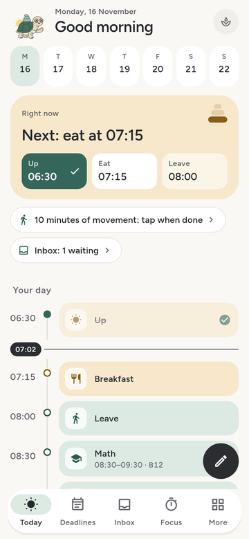
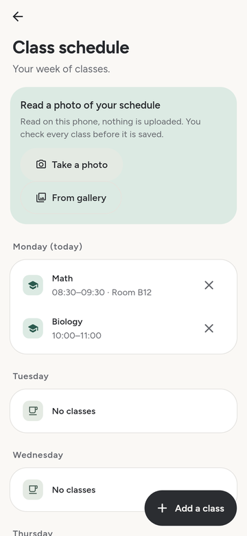
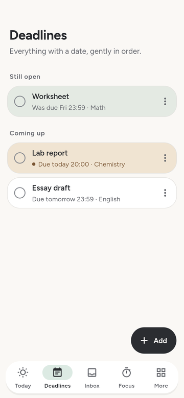
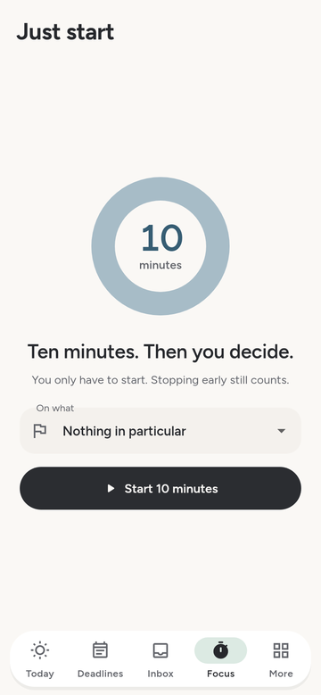

<!-- Improved compatibility of back to top link: See: https://github.com/othneildrew/Best-README-Template/pull/73 -->
<a id="readme-top"></a>

<!-- PROJECT SHIELDS -->
[![Contributors][contributors-shield]][contributors-url]
[![Forks][forks-shield]][forks-url]
[![Stargazers][stars-shield]][stars-url]
[![Issues][issues-shield]][issues-url]


<!-- PROJECT LOGO -->
<br />
<div align="center">
  <a href="https://github.com/xknjmds/pace">
    
  </a>

  <h3 align="center">PACE</h3>

  <p align="center">
    <strong>Progress Always Comes Eventually.</strong>
    <br />
    A calm, offline-first personal routine and productivity app that helps you start the right thing at the right time — without streaks, guilt, or red failure states.
    <br />
    <br />
    <a href="docs/user-guide.md"><strong>User Guide »</strong></a>
    &middot;
    <a href="docs/developer-guide.md"><strong>Developer Guide »</strong></a>
    <br />
    <br />
    <a href="branding/GUIDELINES.md">Brand &amp; Mascot</a>
    &middot;
    <a href="https://github.com/xknjmds/pace/issues/new?labels=bug">Report Bug</a>
    &middot;
    <a href="https://github.com/xknjmds/pace/issues/new?labels=enhancement">Request Feature</a>
  </p>
</div>


<!-- TABLE OF CONTENTS -->
<details>
  <summary>Table of Contents</summary>
  <ol>
    <li>
      <a href="#about-the-project">About The Project</a>
      <ul>
        <li><a href="#key-features">Key Features</a></li>
        <li><a href="#built-with">Built With</a></li>
      </ul>
    </li>
    <li>
      <a href="#getting-started">Getting Started</a>
      <ul>
        <li><a href="#prerequisites">Prerequisites</a></li>
        <li><a href="#installation">Installation</a></li>
        <li><a href="#common-commands">Common Commands</a></li>
      </ul>
    </li>
    <li><a href="#usage">Usage</a></li>
    <li><a href="#roadmap">Roadmap</a></li>
    <li><a href="#contributing">Contributing</a></li>
    <li><a href="#license">License</a></li>
    <li><a href="#contact">Contact</a></li>
    <li><a href="#acknowledgments">Acknowledgments</a></li>
  </ol>
</details>


<!-- ABOUT THE PROJECT -->
## About The Project

<div align="center">
  
  
  
  
</div>

<br />

Most planners give up on you the moment you fall behind. **PACE** adjusts instead.

Built as an external memory and gentle nudge for students and anyone rebuilding a daily routine or recovering from burnout, PACE answers one question every time you open it: *"What do I do right now?"*

* **Forgiving by design:** No punishment, no red failure screens, and no streaks that reset to zero. Missing a day is fine — you just pick up again.
* **Offline-first & private:** Everything lives locally in SQLite with no account required. The only optional network feature is read-only Google Calendar sync.
* **Tuck the turtle:** PACE's quiet companion changes pose throughout the day, respects reduced motion and low-energy mode, and is never sad or disappointed.
* **Android-first, cross-platform core:** Android (`com.el.pace`) is the primary target with exact-alarm reminders, home-screen widgets, on-device schedule OCR, and an escapable app-blocking gate. Web and Desktop (Linux, Windows, macOS) run the full core experience.

### Key Features

* **Leave-by planner & late recovery:** Enter your first class, commute, and prep times per weekday; PACE works backwards to plan wake, breakfast, and leave times — and recalculates a calm recovery plan when mornings run behind.
* **Deadline tracker:** Escalating, gentle nudges (3 days before, 1 day before, morning of, and 2 hours before) with one-tap *"Not today"* muting and forgiving check-in sheets.
* **Quick-capture Inbox:** Jot down thoughts in a couple of taps (from the app, notification shortcut, or Android home-screen widget) and later turn them into deadlines or notes.
* **"Just start" focus timer:** A 10-minute timer to overcome procrastination that survives screen-off and lets you stop or keep going.
* **Evening check-in & sleep log:** Wind-down reminders, tomorrow's preview, Top 3 picker, gradual wake-time shifts, and optional mood check-ins that can suggest a light day tomorrow.
* **Low-energy mode:** Trims every screen, reminder, widget, and app-gate rule down to the essentials on hard days.
* **Class timetable & on-device OCR:** Manage weekly class blocks manually or scan a timetable photo on Android with bundled ML Kit text recognition — always reviewed before saving.
* **Android home-screen widgets:** Quick-capture widget plus a schedule widget with four configurable layouts (list, timeline, now & next, and day progress strip).
* **Escapable app-blocking gate (Android):** Softly locks distracting apps during mornings and wind-down using Usage Access + overlay (no `AccessibilityService`), with an always-available emergency unlock and master switch.
* **Extra modules:** Daily offline Bible verse (World English Bible), movement habit, neutral weekly trends & analytics, Tuck's journey, self-set rewards, standalone notes, expense & budget tracker, and optional read-only Google Calendar sync.

<p align="right">(<a href="#readme-top">back to top</a>)</p>


### Built With

* [![Flutter][Flutter-badge]][Flutter-url]
* [![Dart][Dart-badge]][Dart-url]
* [![Riverpod][Riverpod-badge]][Riverpod-url]
* [![Drift][Drift-badge]][Drift-url]
* [![SQLite][SQLite-badge]][SQLite-url]
* [![Kotlin][Kotlin-badge]][Kotlin-url]
* [![ML Kit][MLKit-badge]][MLKit-url]

<p align="right">(<a href="#readme-top">back to top</a>)</p>


<!-- GETTING STARTED -->
## Getting Started

The Flutter application lives inside the [`pace_app/`](pace_app/) directory. Follow these steps to run PACE locally.

### Prerequisites

* **Flutter SDK** with **Dart SDK `^3.12.2`**
* **Android SDK** with platform API 37 (for Android builds):
  ```sh
  sdkmanager --install "platforms;android-37.0"
  ```
* **Chrome** (for web builds) or the standard Flutter desktop toolchain for Linux, Windows, or macOS.

### Installation

1. Clone the repository:
   ```sh
   git clone https://github.com/xknjmds/pace.git
   cd pace/pace_app
   ```
2. Install Dart and Flutter packages:
   ```sh
   flutter pub get
   ```
3. Generate Drift database and Riverpod provider code:
   ```sh
   dart run build_runner build --delete-conflicting-outputs
   ```
4. Launch the app on an Android device, Chrome, or desktop:
   ```sh
   flutter run
   ```
5. *(Optional)* To enable read-only Google Calendar sync during development, pass your OAuth web client ID:
   ```sh
   flutter run --dart-define=PACE_GOOGLE_CLIENT_ID=<your-web-client-id>
   ```

> **Note:** If Gradle runs out of memory on your machine, override the heap size with `-Dorg.gradle.jvmargs=-Xmx3g`. If you upgrade `sqlite3` or `drift`, regenerate the web SQLite worker with `tool/build_web_db.sh`.

### Common Commands

Run from inside `pace_app/`:

```sh
flutter test                  # Run unit and widget tests
flutter analyze               # Run static analysis
dart format .                 # Format Dart code
flutter build apk --release   # Build release Android APK
flutter build web             # Build web bundle
flutter build linux           # Build Linux desktop app
```

<p align="right">(<a href="#readme-top">back to top</a>)</p>


<!-- USAGE EXAMPLES -->
## Usage

PACE is organized around five bottom tabs:

| Tab | Purpose |
|---|---|
| **Today** | Answers *"what do I do right now?"* — morning steps, day timeline, Top 3, upcoming deadlines, tomorrow preview, and daily verse |
| **Deadlines** | Everything with a due date, ordered calmly with escalating nudges |
| **Inbox** | Fast scratchpad for thoughts; convert any item into a deadline or note in one tap |
| **Focus** | 10-minute *"just start"* timer linked to any task (or none) |
| **More** | Review & Trends, Classes (timetable & photo import), App Gate, Calendar, Notes, Money, Journey, Rewards, Settings, and Reminders |

On first launch, a skippable setup survey configures your weekday class times, commute, prep time, wake target, and (on Android) guided battery/auto-start reminder reliability steps.

_For a complete walkthrough, see the [User Guide](docs/user-guide.md), the [Developer Guide](docs/developer-guide.md), and the [Brand Guidelines](branding/GUIDELINES.md)._

<p align="right">(<a href="#readme-top">back to top</a>)</p>


<!-- ROADMAP -->
## Roadmap

* [x] **v1 Core (M1–M10):** Leave-by planner, late recovery, deadline tracker, Today screen, quick-capture Inbox & widget, "Just start" focus timer, evening check-in & sleep log, low-energy mode, weekly view
* [x] **v2 Phase A:** Offline daily Bible verse, on-device schedule OCR + review, time-block widget, movement habit
* [x] **v2 Phase B:** Escapable Android app-blocking gate, neutral weekly analytics & trends
* [x] **v2 Phase C:** Notes, expense & budget tracker, optional read-only Google Calendar sync
* [x] **v2.1 Polish:** Routine & deadline check-in sheets, 4 configurable Android schedule widget layouts
* [x] **Phase D (Built):** First-run setup survey, recovery plan & evening mood, OEM-guided reminder setup, Tuck's journey, self-set rewards, next-routine suggestions & year-in-review, first-week guidance & splash hand-off
* [ ] **Phase D (Remaining):**
  * [ ] Play Store release & PACE+ billing (`D4`)
  * [ ] On-device activity detection spike & gentle suggestions (`D8–D9`)
  * [ ] Google Calendar OAuth verification (`D10`)
* [ ] **M11:** Optional accounts and offline-first cloud sync (Supabase)

See [`PLAN.md`](PLAN.md) for milestone acceptance criteria and the [open issues](https://github.com/xknjmds/pace/issues) for proposed features and known issues.

<p align="right">(<a href="#readme-top">back to top</a>)</p>


<!-- CONTRIBUTING -->
## Contributing

Contributions are welcome! Before making changes, please read [`CLAUDE.md`](CLAUDE.md) (project rules and architecture invariants) and [`docs/developer-guide.md`](docs/developer-guide.md).

1. Fork the Project
2. Create your Feature Branch (`git checkout -b feature/AmazingFeature`)
3. Run checks before committing (`dart format . && flutter analyze && flutter test` in `pace_app/`)
4. Commit your Changes (`git commit -m 'Add some AmazingFeature'`)
5. Push to the Branch (`git push origin feature/AmazingFeature`)
6. Open a Pull Request

<p align="right">(<a href="#readme-top">back to top</a>)</p>

### Top contributors

<a href="https://github.com/xknjmds/pace/graphs/contributors">
  
</a>


<!-- LICENSE -->
## License

No open-source license file has been added to this repository yet (all rights reserved by default).

Bundled third-party assets carry their own licenses:
* **Figtree** typeface — SIL Open Font License 1.1 (`pace_app/assets/fonts/OFL.txt`)
* **World English Bible** daily verses — Public Domain (`pace_app/assets/verses.json`)

<p align="right">(<a href="#readme-top">back to top</a>)</p>


<!-- CONTACT -->
## Contact

**xkinjou** — eljhonbrana08@gmail.com

Project Link: [https://github.com/xknjmds/pace](https://github.com/xknjmds/pace)

<p align="right">(<a href="#readme-top">back to top</a>)</p>


<!-- ACKNOWLEDGMENTS -->
## Acknowledgments

* [Best-README-Template](https://github.com/othneildrew/Best-README-Template) for the README layout
* [Figtree](https://fonts.google.com/specimen/Figtree) for the UI typeface
* [eBible.org — World English Bible](https://ebible.org/) for the public-domain daily verses
* [Drift](https://drift.simonbinder.eu/), [Riverpod](https://riverpod.dev/), [flutter_local_notifications](https://pub.dev/packages/flutter_local_notifications), [home_widget](https://pub.dev/packages/home_widget), and [Google ML Kit](https://developers.google.com/ml-kit)

<p align="right">(<a href="#readme-top">back to top</a>)</p>


<!-- MARKDOWN LINKS & IMAGES -->
<!-- https://www.markdownguide.org/basic-syntax/#reference-style-links -->
[contributors-shield]: https://img.shields.io/github/contributors/xknjmds/pace.svg?style=for-the-badge
[contributors-url]: https://github.com/xknjmds/pace/graphs/contributors
[forks-shield]: https://img.shields.io/github/forks/xknjmds/pace.svg?style=for-the-badge
[forks-url]: https://github.com/xknjmds/pace/network/members
[stars-shield]: https://img.shields.io/github/stars/xknjmds/pace.svg?style=for-the-badge
[stars-url]: https://github.com/xknjmds/pace/stargazers
[issues-shield]: https://img.shields.io/github/issues/xknjmds/pace.svg?style=for-the-badge
[issues-url]: https://github.com/xknjmds/pace/issues

[Flutter-badge]: https://img.shields.io/badge/Flutter-02569B?style=for-the-badge&logo=flutter&logoColor=white
[Flutter-url]: https://flutter.dev/
[Dart-badge]: https://img.shields.io/badge/Dart-0175C2?style=for-the-badge&logo=dart&logoColor=white
[Dart-url]: https://dart.dev/
[Riverpod-badge]: https://img.shields.io/badge/Riverpod-2D2D2D?style=for-the-badge&logo=dart&logoColor=00B4AB
[Riverpod-url]: https://riverpod.dev/
[Drift-badge]: https://img.shields.io/badge/Drift-1F2937?style=for-the-badge&logo=sqlite&logoColor=white
[Drift-url]: https://drift.simonbinder.eu/
[SQLite-badge]: https://img.shields.io/badge/SQLite-003B57?style=for-the-badge&logo=sqlite&logoColor=white
[SQLite-url]: https://www.sqlite.org/
[Kotlin-badge]: https://img.shields.io/badge/Kotlin-7F52FF?style=for-the-badge&logo=kotlin&logoColor=white
[Kotlin-url]: https://kotlinlang.org/
[MLKit-badge]: https://img.shields.io/badge/Google%20ML%20Kit-4285F4?style=for-the-badge&logo=google&logoColor=white
[MLKit-url]: https://developers.google.com/ml-kit
