# PACE user guide

*Progress Always Comes Eventually.*

PACE is a calm daily companion. It remembers your mornings, classes, deadlines and evenings
so you don't have to, and nudges you to start the right thing at the right time. It is
not a to-do list and it never keeps score. Nothing in PACE goes red, and no count resets
to zero because of a missed day.

Everything stays on your device. There is no account and nothing is sent anywhere, except
Google Calendar if you choose to connect it.

<!-- screens -->

---

## 1. Getting started

These steps take about five minutes. You can skip any of them and come back later.

1. **Set up your week.** Open **More > Settings**. Under **Your week**, tap each weekday
   and enter the time of your first class (or "No class"), how long the commute takes, and
   how long you need to get ready.
2. **Set your mornings.** Still in Settings, choose your **Wake time**, your **Breakfast**
   length and your **Sleep target**. PACE plans the rest.
3. **Turn on reminders (Android).** Open **More > Reminders** and follow the three steps:
   allow notifications, allow exact timing, and turn battery optimisation off for PACE.
   Tap **Send test reminder** to check that one arrives.
4. **Add your deadlines.** Open the **Deadlines** tab and add anything with a due date.
5. **Add your classes (optional).** Open **More > Classes** to enter your timetable, or
   read it from a photo on Android.

From then on, open PACE to the **Today** tab. It answers one question: *what do I do right
now?*

### Your first two weeks

After setup, Today shows a **Getting started** card with a few first things to try: add your
classes, add a deadline, write a thought in Inbox, try a short Focus and (on Android) check
that reminders work. Each one ticks itself when you do it, in any order. Tap **Hide** to put
the card away; **More > Getting started** brings it back. It steps aside by itself after two
weeks, and on low-energy days.

The first time you open each tab, Tuck leaves a short note saying what that place is for.
Tap **Got it** and it won't show again.

## 2. Finding your way around

Five tabs sit at the bottom of the screen:

| Tab | What it's for |
|---|---|
| **Today** | What to do right now, and the shape of your day |
| **Deadlines** | Everything with a due date, in order |
| **Inbox** | Thoughts you wrote down quickly, waiting to be sorted |
| **Focus** | The ten-minute "just start" timer |
| **More** | Everything else, in three groups: **Your week** (Review, Classes, App gate, Calendar), **Keep track** (Notes, Money) and **Keep going** (Journey, Rewards), then Settings and Reminders |

**Deadlines or Inbox?** If it has a due date, it's a deadline. If it's just on your mind, put
it in the Inbox and decide later. An Inbox item can become a deadline or a note with one tap.

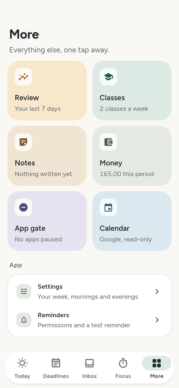

## 3. Today

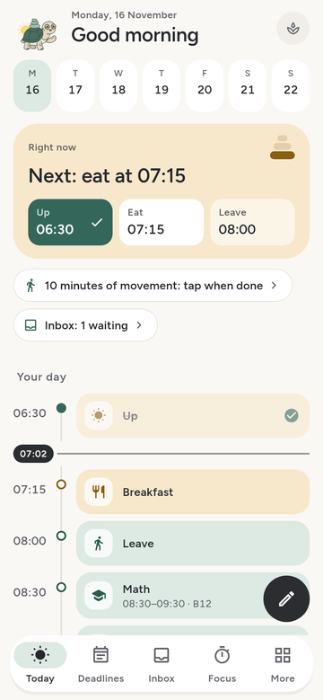

From top to bottom:

- **Greeting and date.** Tuck the turtle changes pose with the time of day.
- **Low-energy button** (top right). Turns low-energy mode on or off. See section 17.
- **Week strip.** The seven days of this week at a glance.
- **Right now.** The next step of your morning (**Up**, **Eat**, **Leave**) with its time.
  Tap a step to check it in.
- **Small reminders.** Your movement habit ("tap when done"), the number of things
  waiting in the Inbox, and the minutes left if a Focus session is running.
- **Your day.** A timeline of today: waking, breakfast, leaving, each class (with room),
  calendar events, anything due today and bedtime. A line marks the current time. Steps
  you've done are ticked. Steps you haven't done stay where they are and are never marked
  as missed.
- **Top 3.** Pick up to three tasks you want to move today.
- **Coming up.** Deadlines due in the next two days.
- **Tomorrow.** One line with tomorrow's first class and when to leave, hidden when there
  is no class.
- **Daily verse.** A Bible verse (World English Bible) that changes each day. You can hide
  it in Settings.
- **Write it down** (the pencil button). Opens the Inbox ready to type.

### When the morning runs behind

If you haven't checked in waking up and it's well past your planned wake time, the
Right now card changes to a single suggestion such as *"Leave now, arrive 8:05."* It
shows one action and an arrival time, and nothing else. **I'm out the door** logs waking
and the routine in one tap. You can still log breakfast afterwards.

### Evenings

From your wind-down time until a few hours after bedtime, Today shows an evening card that
leads to the evening check-in (section 8).

## 4. Checking in a step

Tapping a routine step (wake, eat, leave, wind-down) opens a short sheet:

- **Done on time**
- **Done, a bit later**, where you pick the actual time
- **Didn't happen today**, which quiets that step's reminders for the rest of the day

You can add a short reason if you like (*Overslept*, *Traffic*, *Not feeling well*,
*Plans changed*, or your own words). Tap a done step again to change or clear it.
Whatever you choose, PACE replies calmly, for example *"Logged at 07:40. It still counts."*
or *"Noted. Tomorrow's a fresh start."*

Deadlines use the same sheet: **Submitted**, **Submitted after the due time** (pick when),
or **Couldn't submit**, which closes the deadline without counting it against you.

## 5. Deadlines

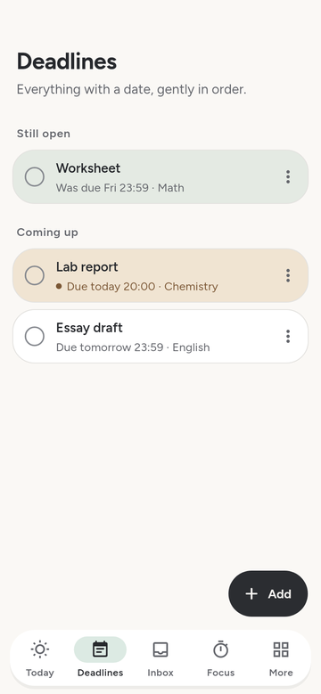

Add a deadline with a title, an optional subject, and a due date and time. PACE then
sends gentle nudges:

| Nudge | When |
|---|---|
| Three days before | 19:00 |
| One day before | 19:00 |
| Morning of | 30 minutes after your wake time |
| Last call | 2 hours before it's due |

Nudges already in the past are skipped, so a deadline added at the last minute may get
none.

From each deadline's menu you can:

- **Submitted**: stops its reminders and moves it to the Submitted list.
- **Not today**: mutes its nudges for today only. It stays open.
- **Just start**: opens the Focus timer with this task selected.
- Edit or delete it. A delete can be undone from the message at the bottom of the screen.

Deadlines whose time has passed move to **Still open**, shown on a soft tint, never in red.

## 6. Inbox (quick capture)

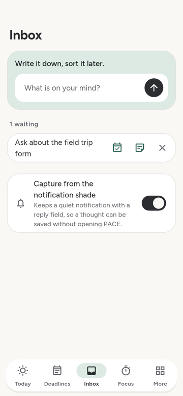

Write a thought down the moment you have it, and sort it later. Each item can become a
**deadline** or a **note**, or be deleted.

There are three quick ways in:

- The pencil button on Today.
- The **quick capture widget** on your home screen (Android), which opens PACE straight
  into the Inbox.
- The **Capture from the notification shade** option (Android, on by default). A quiet
  notification with a reply field stays in your shade. Type there and the thought is saved
  without opening the app. You can turn it off on the Inbox screen.

## 7. Focus: "just start"

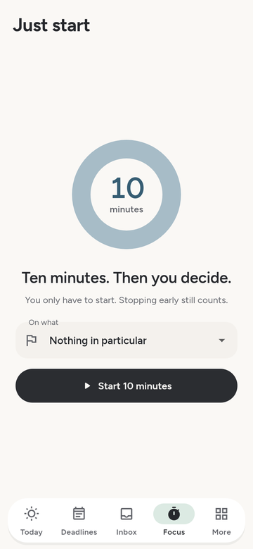

Starting is the hard part, so Focus offers one thing: ten minutes. Pick a task, or
**Nothing in particular**, and tap **Start 10 minutes**.

You can turn the screen off. On Android, PACE tells you when the ten minutes are up. Then
choose **Stop here** or **Keep going, 10 more**. Stopping early still counts.

## 8. Evening check-in and sleep

At wind-down time (bedtime minus your wind-down lead) a reminder offers the evening
check-in. It takes a minute:

1. **Tomorrow**: wake, leave, first class, and anything due in the next two days.
2. **Top 3 for tomorrow**: choosing now means less to decide in the morning.
3. **Wake reminder**: confirms tomorrow's alarm and warns you if reminders are off.
4. **Going to bed**: logs your bedtime.

Every step can be skipped. In the morning, **I'm up** (or checking in the wake step) logs
your wake time. Together they make the sleep log.

**Bedtime is never set by hand.** It comes from your wake time minus your sleep target, so
when you change one, the other follows.

## 9. Review

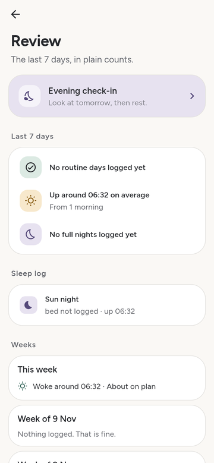

**More > Review** shows the last 7 days in plain counts: days with the routine done, your
average wake time, average sleep, and a sleep log of each night. Below that, **Weeks**
compares the last four weeks: planned and actual wake times, sleep, deadlines submitted,
focus sessions and movement days.

Nothing on this screen is red, and no number goes down because of a missed day. A check-in
done a bit later is shown as a neutral count ("1 a bit later").

## 10. Settings

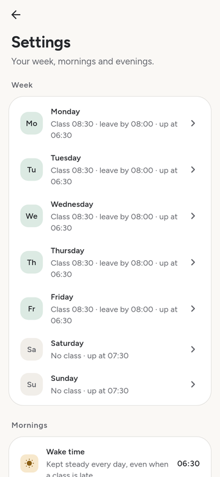

**More > Settings** holds your week and routine.

- **Your week.** Per weekday: first class time (or no class), commute and getting ready.
- **Mornings.** Wake time, breakfast length, and the **weekend lie-in** (Saturday and Sunday
  can wake up to an hour later).
- **Move it earlier, gradually.** Set a wake time to work toward and PACE moves your wake
  time 15 minutes earlier every 3 days until it gets there. A late night doesn't reset or
  stall it. Choose **Stay at this time** to stop.
- **Evenings.** Sleep target and how long before bed to wind down.
- **Low-energy mode**, **Daily verse**, **Movement**, plus links to Classes, App gate and
  Google Calendar.

PACE keeps your wake time steady every day, even on days your class starts later. If your
wake time is too late for a morning, that day's plan uses the latest wake time that works
and says so gently. If commute, getting ready and breakfast can't fit before class at
all, the weekday shows *"That morning does not fit. Check the times."*

## 11. Classes

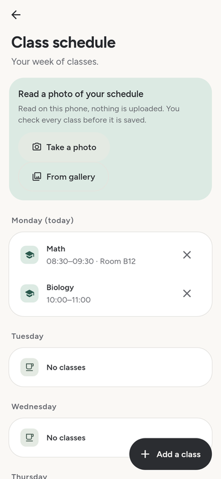

**More > Classes** holds your weekly timetable: subject, day, start and end time, and room.
Classes appear on Today's timeline and on the schedule widget.

**Read a photo of your schedule (Android).** Take a photo or choose one from the gallery.
The text is read on your phone and nothing is uploaded. PACE never saves what it reads
straight away. It shows every class it found so you can fix, delete or add classes, and
saves only when you confirm. If the earliest class on a day differs from that weekday's
first class time in Settings, PACE asks which one to keep. Reading a new photo replaces
classes from the last photo and keeps the ones you typed in.

## 12. Movement habit

One small habit, by default ten minutes of movement. Choose what it's tied to (waking,
breakfast, leaving or wind-down) and how many minutes before or after. The reminder moves
with your routine. One tap marks it done. Review counts done days, and a skipped day
doesn't count against you.

## 13. App gate (Android)

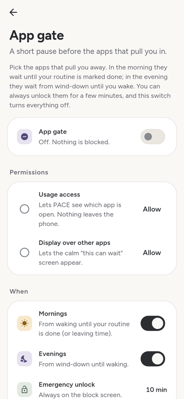

The gate is a short pause before the apps that pull you in. Pick the apps, and they wait:

- **Mornings**: from waking until your routine is done (or until leaving; 90 minutes on
  days without class). Checking in the morning routine opens them right away.
- **Evenings**: from wind-down until waking.

When you open a waiting app, a calm "this can wait" screen appears. **Emergency unlock is
always on that screen** and opens the apps for the number of minutes you choose (10 by
default). The **App gate** switch at the top of the gate screen turns everything off at
once, and the **×** next to an app stops blocking just that one.

The gate needs two Android permissions: **Usage access** (to see which app is open;
nothing leaves the phone) and **Display over other apps** (to show the pause screen). In
low-energy mode the gate loosens: mornings lock only for the first 30 minutes after waking,
and evenings start at bedtime.

## 14. Notes

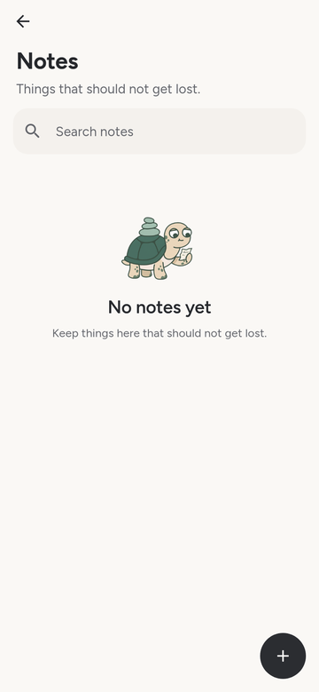

**Notes** is a place for things that shouldn't get lost. Create, edit, search and delete
notes. Search looks in titles and text. Deleting asks first.

## 15. Money

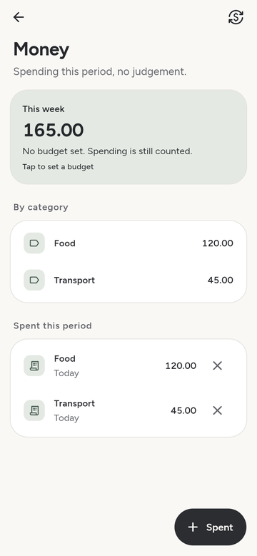

**Money** logs spending in a few taps: tap **Spent**, enter how much, a category and an
optional note. Set a weekly or monthly budget to see spent and remaining, with a summary
by category. Going over budget is described plainly, with no warnings. You can set a
currency code (like PHP or USD) in the same screen.

## 16. Calendar

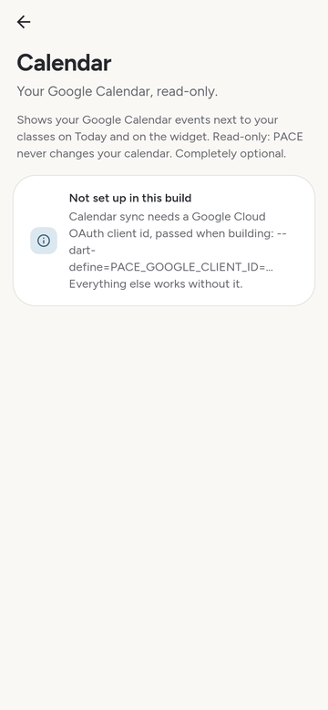

**Calendar** (Android and web, optional) shows your Google Calendar events next to your
classes on Today and on the widget. It is read-only: PACE never changes your calendar.
Events are saved on the device, so they still show offline. Google sometimes asks you to
connect again (about weekly while the app is in testing). When that happens PACE shows a
**Reconnect** button. Signing out removes the saved events.

## 17. Low-energy mode

For days when there's less in the tank. Turn it on from the button at the top of Today or
in Settings. PACE then keeps only what matters:

| Area | In low-energy mode |
|---|---|
| Today | Wake, leave and deadlines due within two days. Top 3, breakfast, the habit, the verse and the tomorrow line are hidden |
| Reminders | Only wake, leave and deadline nudges in the last 48 hours |
| Deadlines, Focus | Only what is due in the next two days |
| Inbox | Folds into one line: "N things waiting. They can wait." |
| Evening check-in | Skips the Top 3 step |
| Review | Shows this week only and folds the sleep log |
| Check-in sheet | Keeps the note field folded |
| App gate | Shorter lock windows |
| Schedule widget | Shows only the class under way and the next one |

## 18. Reminders and their buttons (Android)

| Reminder | Buttons |
|---|---|
| Wake, eat, leave | **Done**, **10 more minutes** (once), **Not today** |
| Deadline nudge | **Submitted**, **Not today** |
| Wind-down | **Going to bed**, **Not today** |
| Movement habit | **Done**, **Not today** |
| Focus time-up | **Stop here**, **Keep going** |

**Not today** silences that one reminder for the rest of the day. It doesn't mark anything
done and doesn't count as a miss. Tapping the body of a wind-down, focus or deadline
reminder opens the matching screen.

## 19. Home-screen widgets (Android)

- **Quick capture**: shows how many things are in the Inbox, with a **Write it down**
  button.
- **Today's classes**: today's classes and calendar events, with the current one
  highlighted. When you place it, choose a layout: **list**, **timeline**, **now & next**,
  or **day progress strip**. You can change it later. It updates on its own at the start
  and end of each class and at midnight, without opening the app.

Both follow dark mode and low-energy mode.

## 20. Web and desktop

PACE also runs in a browser and on Linux, Windows and macOS. Everything works there
except what needs Android: scheduled reminders and their buttons, the capture
notification, home-screen widgets, reading a schedule photo, and the app gate. Calendar
works on Android and the web. Each device keeps its own data; there is no sync between
devices yet.

## 21. Your data and privacy

- All data lives in a database on the device. There is no account and no server.
- The only network use is Google Calendar, and only if you connect it.
- Schedule photos are read on the phone and never uploaded.
- The app gate sees which app is in front only to show the pause screen, and keeps nothing.
- Uninstalling PACE removes its data. Export and backup are planned for a later version.

## 22. If something isn't working

| What you see | What to try |
|---|---|
| Reminders arrive late or not at all | Open **More > Reminders** and finish all three steps. Turn off battery optimisation for PACE. Some phones also need PACE allowed to "auto-start" in the phone's own settings |
| "It may arrive a few minutes late. Exact alarms are off." | Allow **Alarms & reminders** for PACE from the Reminders screen |
| "Reminders did not start properly" on Today | Everything else still works. Open the reminder setup from the card and send a test reminder |
| The App gate doesn't block anything | Pick at least one app and grant both **Usage access** and **Display over other apps** |
| Calendar asks you to reconnect | Tap **Reconnect**. This is normal and happens about weekly for now |
| A photo of the schedule reads poorly | Add or fix the classes by hand on the review screen. Typing them in always works |
